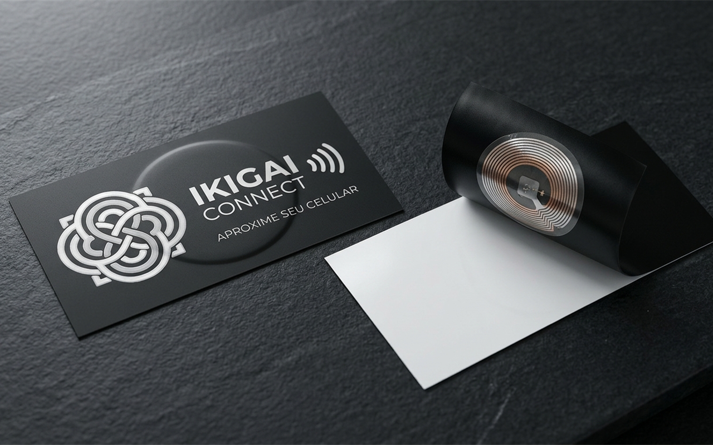
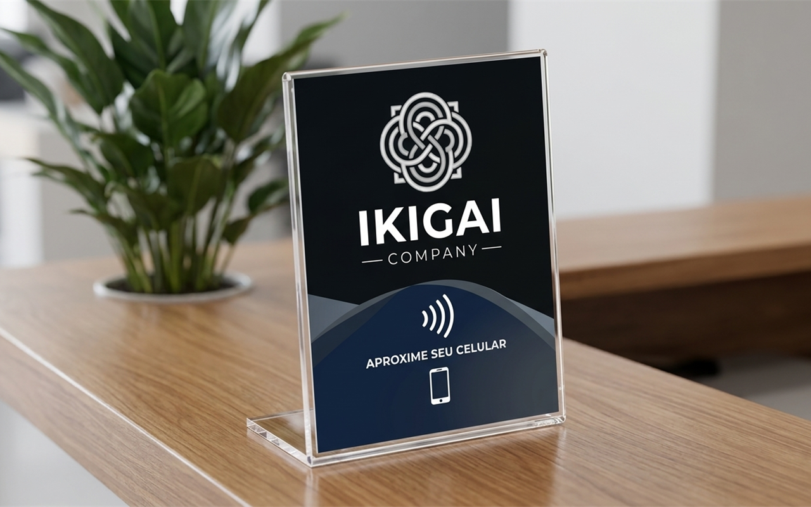
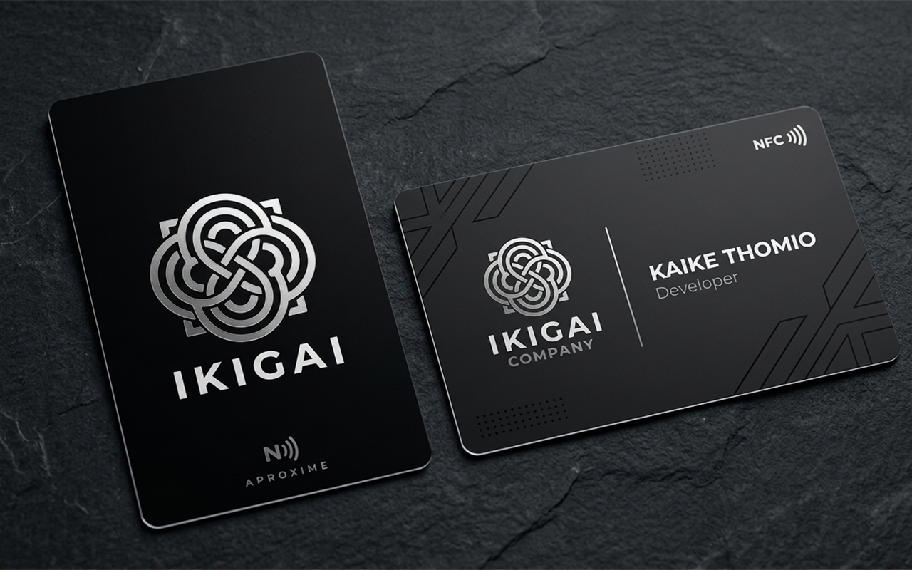
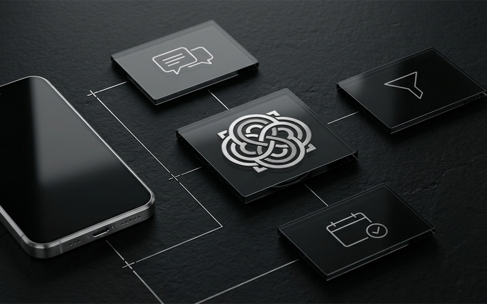

# SPEC DE EXECUÇÃO — IKIGAI COMPANY V5.4 (GERAÇÃO E INTEGRAÇÃO DAS 4 IMAGENS ILUSTRATIVAS REALISTAS COM LOGO OFICIAL IKIGAI)

**Status:** Aprovado pelo Diretor para execução imediata  
**Pasta do Projeto:** `clients/ikigai-company/`  
**Repositório GitHub:** `https://github.com/KThomio/ikigai-company.git` (branch `main`)  
**Skills Obrigatórias na Execução:** `superpowers`, `design-taste-frontend`, `agent-browser`

---

## 1. OBJETIVO CIRÚRGICO

Substituir **apenas os 4 placeholders `[ IMAGEM EM DEFINIÇÃO ]`** do site (`index.html` e `lp/index.html`) por fotografias ilustrativas realistas geradas com o subagent nativo `image-generator` utilizando a logo oficial da **IKIGAI COMPANY** e as referências enviadas pelo Diretor, **sem alterar absolutamente mais nada no restante do site** (preços, textos, combos, estrutura e formulários permanecem intocados).

---

## 2. ESPECIFICAÇÃO EXATA DAS 4 IMAGENS A GERAR (`image-generator`)

Ao invocar o subagent `image-generator`, passe sempre os caminhos absolutos das imagens de referência no prompt do subagent para garantir fidelidade máxima à logo oficial da Ikigai:
- **Logo Oficial Ikigai (Símbolo):** `c:/Users/kauez/Projetos-IA/_AI-AGENCY/clients/ikigai-company/assets/images/ikigai-simbolo-transparente.png`
- **Selo Oficial Ikigai:** `c:/Users/kauez/Projetos-IA/_AI-AGENCY/clients/ikigai-company/assets/images/ikigai-selo-oficial.png`
- **Prancha de Identidade Oficial Ikigai:** `c:/Users/kauez/Projetos-IA/_AI-AGENCY/clients/ikigai-company/assets/images/ikigai-identidade-oficial.jpg`
- **Referência do Totem em Acrílico em L:** `C:/Users/kauez/.gemini/antigravity/brain/073f20f1-02fd-48f0-8b80-0ffafc002ac1/.user_uploaded/media_1794964025485_7f7287d0.jpg`

### Imagem 1 — Etiquetas Adesivas NFC `7×4 cm` com Relevo do Chip `Ø25 mm`
- **Caminho de destino:** `c:/Users/kauez/Projetos-IA/_AI-AGENCY/clients/ikigai-company/assets/images/produto-etiquetas-nfc.png`
- **Briefing obrigatório para o `image-generator`:**
  - Fotografia macro realista de estúdio (proporção horizontal 16:10) de uma **etiqueta adesiva retangular de 7 × 4 cm (70 mm × 40 mm)** aplicada sobre uma superfície escura sofisticada, personalizada em vinil preto fosco/grafite com o **símbolo geométrico prateado oficial da IKIGAI COMPANY** (`c:/Users/kauez/Projetos-IA/_AI-AGENCY/clients/ikigai-company/assets/images/ikigai-simbolo-transparente.png`), texto `IKIGAI CONNECT`, ícone de ondas NFC `)))` e chamada `APROXIME SEU CELULAR`.
  - **DETALHE FÍSICO ESSENCIAL E OBRIGATÓRIO:** Um chip/tag NFC redondo de **25 mm de diâmetro (`Ø25 mm`)** está colado por trás do centro da etiqueta adesiva de `7×4 cm`. A iluminação lateral rasante deve evidenciar com total realismo o **relevo circular suave (emboss/elevação redonda de 25 mm de diâmetro sob o vinil adesivo)** onde o chip NFC fica colado por trás, e mostrar ao lado uma segunda etiqueta semi-destacada do papel liner exibindo o inlay circular metálico de 25 mm colado no verso da etiqueta.

### Imagem 2 — Totem Personalizado NFC em Acrílico `15×10×5 cm`
- **Caminho de destino:** `c:/Users/kauez/Projetos-IA/_AI-AGENCY/clients/ikigai-company/assets/images/produto-totem-nfc.png`
- **Briefing obrigatório para o `image-generator`:**
  - Usar como referência direta a foto `C:/Users/kauez/.gemini/antigravity/brain/073f20f1-02fd-48f0-8b80-0ffafc002ac1/.user_uploaded/media_1794964025485_7f7287d0.jpg` e a logo `c:/Users/kauez/Projetos-IA/_AI-AGENCY/clients/ikigai-company/assets/images/ikigai-simbolo-transparente.png`.
  - Fotografia realista de produto (proporção 16:10) de um **Totem em Acrílico Cristal transparente dobrado em L na medida 15 × 10 × 5 cm** (15 cm de altura vertical, 10 cm de largura e 5 cm de base dobrada para trás apoiada sobre um balcão de madeira nobre/recepção moderna), com bordas de acrílico polido brilhante.
  - Adesivado com a identidade visual da **IKIGAI COMPANY**: no topo, fundo preto obsidian com o **emblema geométrico prateado oficial da Ikigai** + texto `IKIGAI` e `— COMPANY —` (no exato lugar onde a referência diz "SEU LOGO AQUI"); na parte inferior separada por uma curva elegante em grafite/azul-escuro tecnológico, o ícone de ondas NFC `)))`, o texto **`APROXIME SEU CELULAR`** e o ícone minimalista de um smartphone logo abaixo.

### Imagem 3 — Connect Card NFC (Padrão Internacional `CR80` — `85,60 × 53,98 mm`)
- **Caminho de destino:** `c:/Users/kauez/Projetos-IA/_AI-AGENCY/clients/ikigai-company/assets/images/produto-connect-card.png`
- **Briefing obrigatório para o `image-generator`:**
  - Usar como referência a logo `c:/Users/kauez/Projetos-IA/_AI-AGENCY/clients/ikigai-company/assets/images/ikigai-simbolo-transparente.png` e a prancha `c:/Users/kauez/Projetos-IA/_AI-AGENCY/clients/ikigai-company/assets/images/ikigai-identidade-oficial.jpg`.
  - Fotografia realista de estúdio (proporção 16:10) mostrando a **Frente (Vertical `53,98 × 85,60 mm`)** e o **Verso (Horizontal `85,60 × 53,98 mm`)** do cartão de visita digital NFC da **IKIGAI COMPANY** no padrão oficial **ISO/IEC 7810 ID-1 (CR80)** em PVC adesivado preto fosco/grafite com acabamento em verniz prata:
    - **Cartão da Frente (em pé / vertical):** Fundo preto fosco/grafite, no centro o emblema geométrico prateado oficial da Ikigai + texto `I K I G A I` espaçado logo abaixo, e na base inferior o símbolo `N)))` + texto `A P R O X I M E`.
    - **Cartão do Verso (deitado / horizontal ao lado):** Fundo preto fosco/grafite com linhas sutis de circuito e matriz de pontos, `NFC )))` no canto superior direito, lado esquerdo (separado por linha vertical fina) com o emblema da Ikigai + `IKIGAI COMPANY`, e lado direito com `KAIKE THOMIO` / `Developer`.

### Imagem 4 — Automações de Processos (`03 // AUTOMAÇÕES`)
- **Caminho de destino:** `c:/Users/kauez/Projetos-IA/_AI-AGENCY/clients/ikigai-company/assets/images/produto-automacoes.png`
- **Briefing obrigatório para o `image-generator`:**
  - Usar como referência `c:/Users/kauez/Projetos-IA/_AI-AGENCY/clients/ikigai-company/assets/images/ikigai-simbolo-transparente.png`.
  - Composição visual realista e sofisticada (proporção 16:10) na estética Obsidian & Platinum (`#0D0E11` e `#EAECEF`) mostrando um smartphone premium em ambiente escuro conectado a cards holográficos/interfaces limpas de automação comercial de WhatsApp e Instagram (Recebimento Instantâneo → Triagem Inteligente → Agendamento / Orçamento) com o símbolo da **IKIGAI COMPANY** integrado.

---

## 3. INTEGRAÇÃO HTML EM `index.html` E `lp/index.html` (SELO ILUSTRATIVO PADRONIZADO)

Substituir **apenas** o bloco `<div class="relative aspect-[16/10] ...">...</div>` dos 4 itens que possuem `[ IMAGEM EM DEFINIÇÃO ]`, aplicando exatamente a mesma estrutura do Card 01 (Placa Google), com o selo técnico superior:
`IMAGEM ILUSTRATIVA // PERSONALIZÁVEL COM SUA MARCA` (nos 3 produtos físicos) e `IMAGEM ILUSTRATIVA // FLUXO AUTOMATIZADO` (em Automações):

1. **Produto 02 (`Ikigai Connect — Etiquetas Adesivas NFC`):**
   ```html
   <div class="relative aspect-[16/10] overflow-hidden bg-ik-carbon border-b border-white/10">
     
     <span class="absolute top-3 left-3 font-mono text-[9px] tracking-[0.16em] uppercase px-2.5 py-1 bg-ik-obsidian/90 border border-white/20 text-ik-platinum">
       IMAGEM ILUSTRATIVA // PERSONALIZÁVEL COM SUA MARCA
     </span>
   </div>
   ```

2. **Produto 03 (`Totem Personalizado NFC (15 × 10 cm)`):**
   ```html
   <div class="relative aspect-[16/10] overflow-hidden bg-ik-carbon border-b border-white/10">
     
     <span class="absolute top-3 left-3 font-mono text-[9px] tracking-[0.16em] uppercase px-2.5 py-1 bg-ik-obsidian/90 border border-white/20 text-ik-platinum">
       IMAGEM ILUSTRATIVA // PERSONALIZÁVEL COM SUA MARCA
     </span>
   </div>
   ```

3. **Produto 04 (`Connect Card — Cartão Digital NFC`):**
   ```html
   <div class="relative aspect-[16/10] overflow-hidden bg-ik-carbon border-b border-white/10">
     
     <span class="absolute top-3 left-3 font-mono text-[9px] tracking-[0.16em] uppercase px-2.5 py-1 bg-ik-obsidian/90 border border-white/20 text-ik-platinum">
       IMAGEM ILUSTRATIVA // PERSONALIZÁVEL COM SUA MARCA
     </span>
   </div>
   ```

4. **Solução Digital 03 (`Automações de Processos`):**
   ```html
   <div class="relative aspect-[16/10] overflow-hidden bg-ik-carbon border border-white/15">
     
     <span class="absolute top-2.5 left-2.5 font-mono text-[9px] tracking-[0.16em] uppercase px-2 py-0.5 bg-ik-obsidian/90 border border-white/20 text-ik-platinum">
       IMAGEM ILUSTRATIVA // FLUXO AUTOMATIZADO
     </span>
   </div>
   ```

---

## 4. REGRAS INVIOLÁVEIS E VERIFICAÇÃO FINAL

1. **PROIBIDO ALTERAR QUALQUER OUTRA PARTE DO SITE:** Preços, combos, textos, botões, links WhatsApp (`5511943758597`), Hero e estrutura permanecem 100% idênticos à V5.3.
2. **Inspeção Visual Obrigatória das 4 Imagens Geradas (`read_file`):**
   - Inspecionar cada uma das 4 imagens geradas com `read_file` antes de prosseguir, confirmando:
     - O relevo circular do chip de 25 mm na etiqueta de `7×4 cm`;
     - O formato em L de acrílico `15×10×5 cm` com a logo da Ikigai no totem;
     - O padrão CR80 (frente vertical + verso horizontal) com a logo da Ikigai no Connect Card;
     - A estética Obsidian & Platinum no card de Automações.
3. **Zero Placeholders Restantes:** Confirmar que `IMAGEM EM DEFINIÇÃO` retorna **0 ocorrências** em `index.html` e `lp/index.html`.
4. **Sincronização, Auditoria no Navegador (`375px` e `1440px`), `STATE.md`, Commit & Push na branch `main`.**
